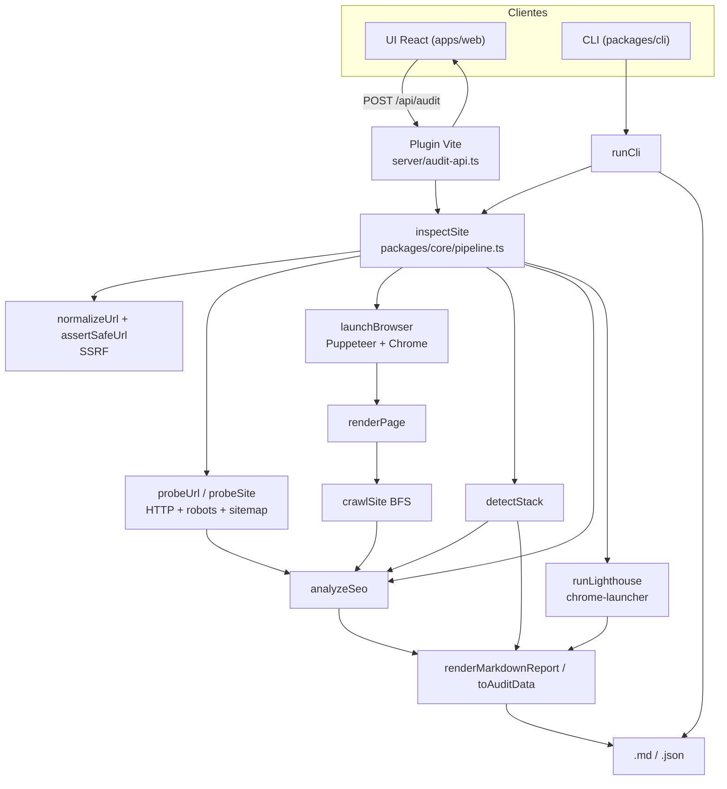
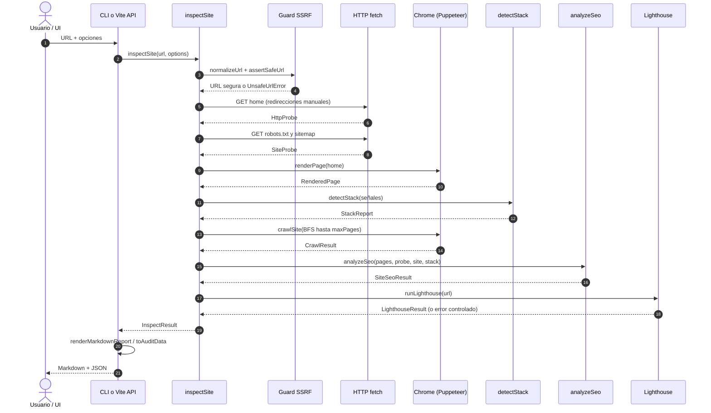
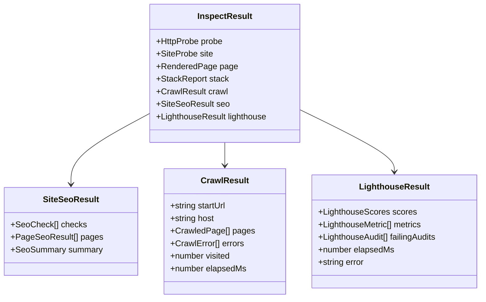

# Arquitectura

Documento de referencia del proyecto `seo-audit`. Describe el contexto, los componentes, el flujo de datos, los contratos y las decisiones de diseño. Los diagramas están en ASCII (visibles en cualquier editor) y en Mermaid (GitHub, GitLab, VS Code, Obsidian y la mayoría de visores Markdown). La fuente Mermaid del diagrama principal está en [`architecture.mmd`](architecture.mmd).

## 1. Objetivo y alcance

El sistema responde a una pregunta: **¿qué problemas SEO, de rendimiento y de calidad tiene este sitio y cómo se corrigen con su stack actual?**

Alcance del MVP:

- Auditar una URL pública (o privada con `--allow-private`).
- Renderizar con Chrome real para sitios dependientes de JavaScript.
- Rastrear un número acotado de páginas internas del mismo host.
- Detectar tecnologías y adaptar las recomendaciones.
- Ejecutar Lighthouse en local.
- Entregar un informe Markdown y, opcionalmente, JSON.
- Ofrecer CLI y UI web sobre el mismo motor.

Fuera de alcance (por decisión de diseño):

- Persistencia, histórico, cuentas de usuario o multiusuario.
- Programación de auditorías o servicio en la nube.
- Comparación entre ejecuciones.
- Análisis semántico del contenido ni intención de búsqueda.
- Crawl de subdominios o dominios externos.

## 2. Contexto

```
                         +---------------------------+
                         |        Usuario/a          |
                         +-------------+-------------+
                                       |
                 +---------------------+---------------------+
                 |                                           |
       +---------v----------+                     +----------v-----------+
       | CLI                |                     | Navegador            |
       | npm run audit --   |                     | http://localhost:5173|
       +---------+----------+                     +----------+-----------+
                 |                                           |
                 |                                  +--------v-----------+
                 |                                  | UI React (apps/web)|
                 |                                  +--------+-----------+
                 |                                           | POST /api/audit
                 |                                  +--------v-----------+
                 |                                  | Plugin Vite        |
                 |                                  | audit-api.ts       |
                 |                                  +--------+-----------+
                 |                                           |
                 +------------------+------------------------+
                                    |
                          +---------v----------+
                          | packages/core      |
                          | inspectSite()      |
                          +---------+----------+
                                    |
          +-------------------------+--------------------------+
          |                         |                          |
 +--------v--------+      +---------v---------+      +---------v---------+
 | HTTP fetch      |      | Chrome (Puppeteer)|      | Lighthouse        |
 | probe/robots/   |      | render + crawl    |      | Chrome aparte     |
 | sitemap         |      |                   |      |                   |
 +-----------------+      +-------------------+      +-------------------+
```

El sistema no llama a APIs de terceros. Solo hace peticiones HTTP al sitio auditado y habla con Chrome vía CDP en localhost.

## 3. Contenedores y componentes

### 3.1 Vista ASCII

```
+------------------------------- apps/web --------------------------------+
|  React 19 + Vite 8 + Tailwind 4                                        |
|  AuditForm -> App -> Summary / LighthousePanel / IssuesPanel / PagesTable|
|                     |                                                   |
|                     | fetch('/api/audit')                               |
|                     v                                                   |
|  server/audit-api.ts (middleware Vite, dev y preview)                  |
|    - valida método y cuerpo (16 KiB)                                    |
|    - maxPages 1..30, lighthouse, allowPrivate                          |
|    - inspectSite() -> toAuditData() + renderMarkdownReport()           |
+----------------------------------+-------------------------------------+
                                   |
+------------------------------ packages/core ---------------------------+
|  pipeline.ts: inspectSite()                                            |
|                                                                        |
|  url.ts ---------> normalizeUrl + assertSafeUrl (SSRF)                 |
|  probe.ts -------> probeUrl + probeSite (robots, sitemap)              |
|  render.ts ------> launchBrowser + renderPage (Puppeteer)              |
|  crawl.ts -------> crawlSite (BFS mismo host, dedupe, maxPages)        |
|  detect/stack.ts -> detectStack (headers, HTML, cookies, DOM, assets)  |
|  seo/index.ts ---> analyzeSeo (page-checks + site-checks + fixes)      |
|  perf/lighthouse  -> runLighthouse (chrome-launcher + Lighthouse)      |
|  report/markdown  -> renderMarkdownReport                             |
|  report/json -----> toAuditData                                       |
+----------------------------------+-------------------------------------+
                                   |
+------------------------------ packages/cli ---------------------------+
|  args.ts -> parseArgs / reportFileName / resolveReportPath             |
|  index.ts -> runCli (progreso, escritura .md y .json, códigos de salida)|
|  cli.ts --> entrypoint (process.argv)                                  |
+------------------------------------------------------------------------+
```

### 3.2 Vista Mermaid



## 4. Flujo de una auditoría



Pasos:

1. **Normalización y guard**: se añade `https://` si falta esquema, se elimina el hash y se valida el host (incluida resolución DNS).
2. **Probe HTTP**: `fetch` con `redirect: manual`; cada salto vuelve a pasar por el guard. Se leen cabeceras, cookies `Set-Cookie`, HTML limitado y cadena de redirecciones. En paralelo lógico (secuencial en código) se consultan `robots.txt` y sitemaps declarados o habituales.
3. **Render**: se lanza Chrome headless con Puppeteer. La home se navega con `networkidle2`, viewport 1366×900 y timeout de 45 s por defecto. Se capturan HTML final, título, cookies, recursos de `performance`, enlaces y errores de consola.
4. **Crawl**: BFS desde los enlaces de la home. Solo mismo host, sin assets, sin parámetros de tracking, deduplicado por host + path + query ordenada, con `maxPages` como tope. Los errores por página se registran y no abortan la auditoría.
5. **Detección de stack**: reglas sobre cabeceras, HTML, cookies, globals del DOM y URLs de recursos.
6. **SEO**: 18 comprobaciones por página + 12 de sitio, agrupadas en un resumen `pass/warn/fail`.
7. **Lighthouse**: se cierra el navegador del crawl y se lanza una instancia aparte de Chrome con `chrome-launcher`. Si falla, se devuelve `LighthouseResult.error` y el informe continúa.
8. **Informe**: Markdown agrupado por `id + estado`; JSON con `AuditData`.

### Cierre de Chrome

`inspectWithBrowser` envuelve render + crawl en `try/finally` y cierra el navegador antes de lanzar Lighthouse. Lighthouse usa su propia instancia y la mata en `finally`. Esto evita dos Chromes compitiendo y reduce picos de memoria.

## 5. Módulos y responsabilidades

| Módulo | Responsabilidad | Entradas / salidas clave |
| --- | --- | --- |
| `packages/core/src/url.ts` | Normalizar URLs y bloquear SSRF | `URL` / `UnsafeUrlError` |
| `probe.ts` | HTTP acotado con redirecciones seguras; robots y sitemap | `HttpProbe`, `SiteProbe` |
| `chrome.ts` | Resolver el ejecutable de Chrome (`CHROME_PATH` o rutas conocidas) | ruta absoluta |
| `render.ts` | Lanzar Chrome y extraer una `RenderedPage` | `Browser`, `RenderedPage` |
| `crawl.ts` | BFS interno con dedupe y límite | `CrawlResult` |
| `detect/stack.ts` | 31 reglas de señal → 28 identificadores de tecnología | `StackReport` |
| `seo/parse.ts` | Extraer datos SEO del HTML renderizado | `PageSeoData` |
| `seo/page-checks.ts` | 18 comprobaciones por página | `SeoCheck[]` |
| `seo/site-checks.ts` | 12 comprobaciones de sitio | `SeoCheck[]` |
| `seo/fixes.ts` | Contexto de stack y recomendaciones específicas | `StackContext`, `fixFor()` |
| `seo/index.ts` | Orquestar checks y resumen | `SiteSeoResult` |
| `perf/lighthouse.ts` | Ejecutar y resumir Lighthouse | `LighthouseResult` |
| `report/markdown.ts` | Informe legible en español | `string` Markdown |
| `report/json.ts` | Proyección estable para integraciones | `AuditData` |
| `pipeline.ts` | Orquestación completa | `InspectResult` |
| `packages/cli/src/args.ts` | Parseo de flags y rutas de salida | `CliOptions` |
| `packages/cli/src/index.ts` | Ejecutar, progresar, escribir y reportar | código de salida |
| `apps/web/server/audit-api.ts` | Endpoint local `POST /api/audit` | `AuditResponse` |
| `apps/web/src/*` | Formulario, resumen, paneles, tabla y descarga | UI |

## 6. Contratos de datos

```
InspectResult
├─ probe: HttpProbe            # respuesta HTTP de la home
├─ site: SiteProbe             # robots.txt + sitemap
├─ page: RenderedPage          # home renderizada en Chrome
├─ stack: StackReport          # tecnologías + evidencias + notas
├─ crawl: CrawlResult          # páginas, errores, visitadas, duración
├─ seo: SiteSeoResult          # checks[], pages[], summary
└─ lighthouse?: LighthouseResult
```

Tipos principales:

| Tipo | Campos relevantes |
| --- | --- |
| `HttpProbe` | `url`, `finalUrl`, `status`, `headers`, `setCookies`, `html`, `htmlBytes`, `truncated`, `redirectChain`, `elapsedMs`, `error?` |
| `SiteProbe` | `robots`, `sitemap`, `sitemapsDeclared` (`ResourceProbe` con `found`, `bytes`, `text`, `urlsCount`) |
| `RenderedPage` | `url`, `finalUrl`, `status`, `headers`, `html`, `title`, `cookieNames`, `resources`, `links`, `consoleErrors`, `dom`, `elapsedMs`, `error?` |
| `CrawlResult` | `startUrl`, `host`, `pages: CrawledPage[]`, `errors`, `visited`, `elapsedMs` |
| `StackReport` | `technologies[]` (`id`, `name`, `category`, `confidence`, `evidence[]`), `primaryStack[]`, `notes[]` |
| `PageSeoData` | title, description, robots, canonical, lang, viewport, headings, imágenes, enlaces, palabras, OG/Twitter, JSON-LD, hreflang, mixed content |
| `SeoCheck` | `id`, `category`, `status`, `severity`, `title`, `detail`, `evidence?`, `fix?`, `pageUrl?` |
| `SiteSeoResult` | `checks[]`, `pages: PageSeoResult[]`, `summary: { pass, warn, fail }` |
| `LighthouseResult` | `scores`, `metrics[]`, `failingAudits[]`, `elapsedMs`, `error?` |
| `AuditData` | URL, fecha, estado, redirecciones, stack, SEO, Lighthouse, resumen de crawl y recursos pesados |

`AuditData` es la frontera pública para la UI y para `--json`; `InspectResult` es el contrato interno del motor. La UI no importa tipos de Puppeteer ni de Lighthouse.



## 7. Detalle de las etapas

### 7.1 Guard SSRF (`url.ts`)

- Solo `http:` y `https:`; añade `https://` si no hay esquema.
- Bloquea hostnames: `localhost`, `localhost.localdomain`, `metadata.google.internal`, `metadata.goog`, sufijos `.localhost`, `.local`, `.internal`, `.home.arpa`.
- Bloquea IPv4: `0.0.0.0/8`, `10/8`, `100.64/10`, `127/8`, `169.254/16`, `172.16/12`, `192.0.0/24`, `192.0.2/24`, `192.168/16`, `198.18/15`, `198.51.100/24`, `203.0.113/24`, `224/4`, `240/4`.
- Bloquea IPv6: `::`, `::1`, `fc00::/7`, `fe80::/10`, `ff00::/8` y IPv4 mapeadas inseguras.
- Resuelve DNS con `lookup({ all: true })` y valida todas las direcciones.
- `allowPrivateHosts` desactiva el guard de forma explícita.

### 7.2 Probe HTTP (`probe.ts`)

- `redirect: manual` con máximo 5 redirecciones; cada salto se revalida con `assertSafeUrl`.
- Timeout por petición: 20 s por defecto.
- HTML: 5 MiB; recursos de texto (robots/sitemap): 1 MiB.
- `readTextLimited` corta el stream y marca `truncated` sin cargar el cuerpo completo.
- Los errores no lanzan: devuelven un `HttpProbe` con `status: 0` y `error`.
- `probeSite` prueba primero los sitemaps declarados en `robots.txt` y luego `/sitemap.xml` y `/sitemap_index.xml`.

### 7.3 Render y crawl

- Puppeteer `headless: true`, `protocolTimeout: 60 s`, viewport 1366×900.
- `page.goto` con `networkidle2` y timeout configurable (45 s por defecto).
- Extracción dentro de `page.evaluate`: HTML final, título, `performance.getEntriesByType('resource')`, enlaces `a[href]` (máx. 500), señales de framework en `window`, scripts y links.
- Errores de consola y `pageerror` se limitan a 50 entradas de 500 caracteres.
- Crawl: cola FIFO, mismo host, `maxPages` (10 por defecto), extensión de assets excluida, parámetros de tracking eliminados solo para deduplicar, hash eliminado.
- `onPage` permite a la CLI mostrar `[n/max] URL`.

### 7.4 Detección de stack

Señales combinadas:

- Cabeceras (`server`, `x-powered-by`, `via`, `cf-ray`, `x-vercel-*`, `x-nf-*`, etc.).
- HTML (`meta generator`, patrones de scripts, rutas, comentarios, atributos).
- Cookies (`wordpress_`, `PHPSESSID`, `laravel_session`, etc.).
- Globals del DOM (`__NEXT_DATA__`, `__NUXT__`, `Vue`, `angular`, `React`, `__sveltekit`, `__remixContext`, `firebase`, `jQuery`, `___gatsby`).
- Recursos (URLs de CDN, bundles, estilos).

Categorías: `CMS`, `Framework`, `Librería`, `Runtime`, `Backend`, `E-commerce`, `Hosting/CDN`, `Base de datos`, `Stack`. Cada tecnología incluye evidencias y confianza (`alta`, `media`, `baja`). Las reglas compuestas detectan MERN y MEAN.

### 7.5 SEO

**Por página (18):** `http-status`, `title`, `meta-description`, `h1`, `heading-hierarchy`, `canonical`, `lang`, `viewport`, `open-graph`, `twitter-card`, `json-ld`, `image-alt`, `word-count`, `internal-links`, `meta-robots`, `mixed-content`, `url-structure`, `hreflang`.

**De sitio (12):** `https`, `hsts`, `csp`, `x-content-type-options`, `referrer-policy`, `frame-options`, `redirects`, `robots`, `sitemap`, `duplicate-titles`, `duplicate-descriptions`, `crawl-status`.

Cada check tiene severidad (`critico`, `alto`, `medio`, `bajo`), estado (`pass`, `warn`, `fail`), detalle, evidencia opcional y `fix` contextual. Los fixes se eligen según el stack detectado (por ejemplo, sugerencias de plugin SEO en WordPress o de metadata en Next.js).

### 7.6 Lighthouse

- Categorías: `performance`, `accessibility`, `best-practices`, `seo`.
- Métricas: FCP, LCP, TBT, CLS, Speed Index, TTI.
- Se descartan auditorías `notApplicable`, `informative` y `manual`.
- Severidad: peso ≥ 10 → alto; peso ≥ 3 → alto si score 0, si no medio; resto → medio si score 0, si no bajo.
- Se ordenan por peso descendente y score ascendente.
- Chrome se valida con `existsSync` antes de `chrome-launcher`; si no existe, se devuelve un error controlado (TD-01).

### 7.7 Informe

Secciones: Resumen ejecutivo, Hallazgos prioritarios, Stack tecnológico, Lo que ya funciona, Problemas encontrados (por severidad), Rendimiento y calidad, Accesibilidad y buenas prácticas, Páginas analizadas, Plan de acción priorizado, Anexo técnico y Limitaciones.

Límites de presentación: 5 hallazgos prioritarios, 20 comprobaciones correctas, 40 problemas por severidad, 12 acciones en el plan. Los checks se agrupan por `id + estado` para no repetir el mismo problema en cada página; se conserva el número de URLs afectadas.

## 8. Seguridad

Modelo de confianza: **herramienta local para URLs elegidas por el usuario**. No está pensada para exponerse a Internet.

| Control | Implementación |
| --- | --- |
| SSRF en probe | Guard por salto de redirección + DNS |
| Límite de cuerpo | 16 KiB en la API; 5 MiB HTML / 1 MiB texto en probe |
| Superficie HTTP | Solo `POST /api/audit`; `405` para otros métodos |
| Errores de cliente | URL insegura → `400`; resto → `500` |
| Hosts privados | Bloqueados salvo `allowPrivateHosts` / `--allow-private` |
| Sin secretos | No hay credenciales ni telemetría |
| Ejecución | Chrome local headless; sin descarga de binarios |

Riesgo residual importante: la navegación de Chrome y sus subpeticiones **no** pasan por el guard SSRF. Una URL pública que redirija a una IP privada podría ser cargada por Chrome y parte de su contenido acabar en el informe. Mitigación actual: no exponer la API y usar `allowPrivate` solo en desarrollo. Ver TD-03 en [`TECHNICAL-DEBT.md`](TECHNICAL-DEBT.md).

## 9. Manejo de errores

| Falla | Comportamiento |
| --- | --- |
| URL inválida o insegura | `UnsafeUrlError`; CLI código 1; API 400 |
| Error de red en probe | `HttpProbe.error`, `status: 0`; se continúa con Chrome |
| Error de navegación | `RenderedPage.error`; se conserva lo cargado |
| Página del crawl falla | Se registra en `CrawlResult.errors` y se sigue |
| Chrome no encontrado | Error controlado al lanzar render o Lighthouse |
| Lighthouse falla | `LighthouseResult.error`; el informe se genera igual |
| Página sin datos | Checks con `status`/`severity` coherentes y `detail` explicativo |

## 10. Decisiones de diseño

| Decisión | Motivo | Consecuencia |
| --- | --- | --- |
| Renderizar con Chrome real | Muchos sitios son SPA y el HTML crudo no representa el DOM final | Más lento y requiere Chrome instalado |
| Crawl secuencial y acotado | Simplicidad, menos carga en el sitio y resultados reproducibles | 30 páginas pueden tardar minutos |
| Sin base de datos | Herramienta local, informes como artefactos | Sin histórico ni comparación |
| Lighthouse en Chrome aparte | Evita interferencias con Puppeteer y permite medir la home limpia | Un proceso más y ~8–20 s extra |
| Fingerprints propios | Evitar dependencias con licencias restrictivas | Cobertura heurística y mantenimiento manual |
| Informe en Markdown | Legible, versionable y compatible con cualquier herramienta | Presentación menos rica que HTML/PDF |
| Fixes contextuales por stack | Recomendaciones accionables, no genéricas | Requiere mantener reglas por tecnología |
| Monorepo con core TS fuente | Iteración rápida sin paso de build | Core no publicable aún (TD-02) |
| Guard SSRF explícito | Evitar que una herramienta local se convierta en vector de acceso a la red interna | Falsos negativos posibles; `--allow-private` para desarrollo |

## 11. Puntos de extensión

- **Nuevo check de página**: añadir en `seo/page-checks.ts` con `id`, categoría, severidad, detalle y `fix`.
- **Nuevo check de sitio**: añadir en `seo/site-checks.ts`; si necesita datos nuevos, ampliar `SiteChecksInput`.
- **Nueva regla de stack**: añadir a `RULES` en `detect/stack.ts` con `id`, nombre, categoría y función `detect`.
- **Nuevo fix contextual**: ampliar `fixFor()` y `StackContext` en `seo/fixes.ts`.
- **Nueva métrica de Lighthouse**: añadir a `METRICS` en `perf/lighthouse.ts`.
- **Nueva sección del informe**: añadir un `render*Section` en `report/markdown.ts`.
- **Nuevo campo público**: ampliar `AuditData` en `report/json.ts` y los tipos de la UI.
- **Nueva UI**: consumir `POST /api/audit` o importar el core desde Node/tsx.

## 12. Rendimiento y límites

- El coste dominante es el render/crawl (≈1–5 s por página) y Lighthouse (≈8–20 s).
- El crawl es secuencial: no hay concurrencia de páginas.
- Una auditoría de 10 páginas con Lighthouse suele tardar entre 30 s y 2 min según el sitio.
- `networkidle2` puede esperar hasta el timeout en páginas con polling o websockets.
- Los cuerpos y listas están acotados para evitar consumo de memoria descontrolado.
- Los informes no se cargan en memoria más allá del tamaño del texto generado.

## 13. Testing

- **Unitarios** (Vitest): URL/SSRF, crawl, stack, checks SEO, resumen de Lighthouse con Chrome mockeado, Markdown, argumentos y CLI.
- Los tests no requieren Chrome ni red.
- **Smoke manual** con `npm run smoke` y auditorías reales con `npm run audit`.
- Lighthouse se mockea con `vi.hoisted` para evitar `spawn ENOENT` y tests frágiles.
- La UI y el endpoint de Vite no tienen tests automatizados todavía (TD-06).

## 14. Operación

| Modo | Comando | Puerto | API |
| --- | --- | --- | --- |
| CLI | `npm run audit -- <url>` | — | — |
| Desarrollo web | `npm run dev` | 5173 | Plugin Vite |
| Preview del build | `npm run build:web` + `npm run preview` | 4173 | Plugin Vite |
| Smoke del motor | `npm run smoke -- <url>` | — | — |

Los informes van a `reports/` por defecto; la carpeta está ignorada por git. La API no debe publicarse en Internet.

## 15. Deuda y evolución

La auditoría de deuda técnica, con prioridades, evidencia y plan de remediación, está en [`TECHNICAL-DEBT.md`](TECHNICAL-DEBT.md). Las líneas de evolución recomendadas son: empaquetado del core, CI, cierre del riesgo SSRF en Chrome, cumplimiento de `robots.txt` y tests de la capa web.
